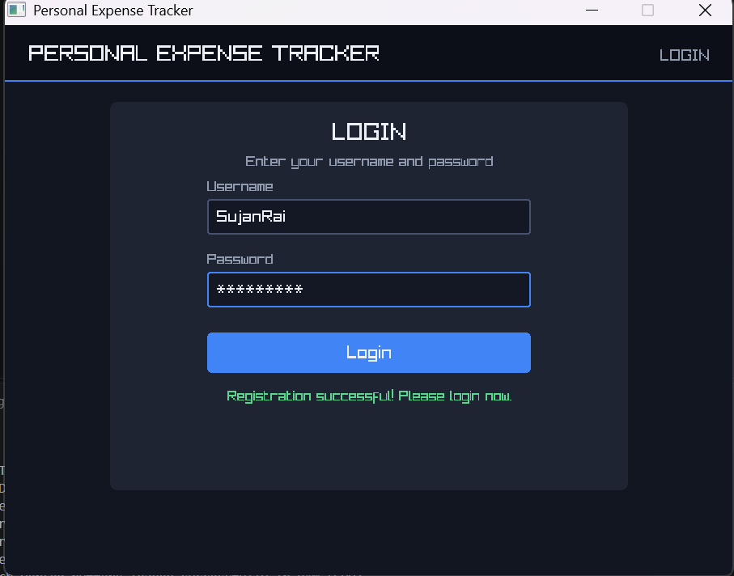
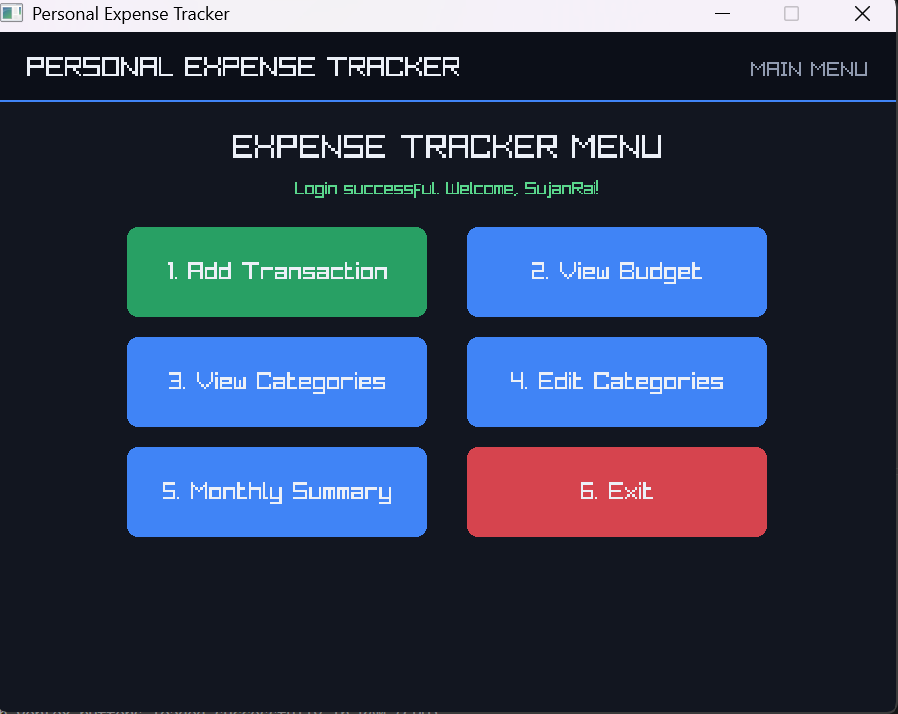
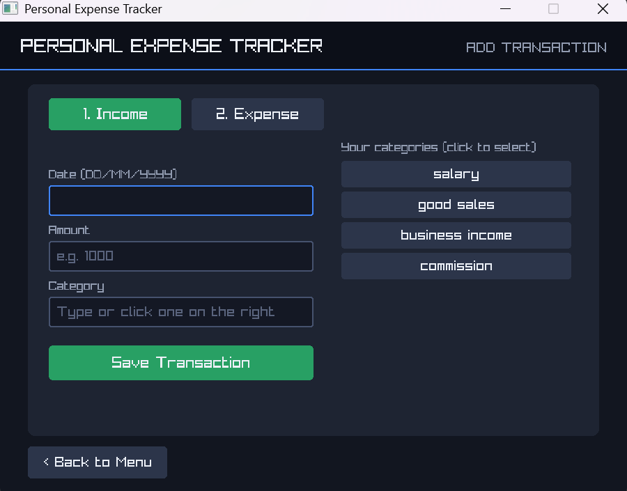
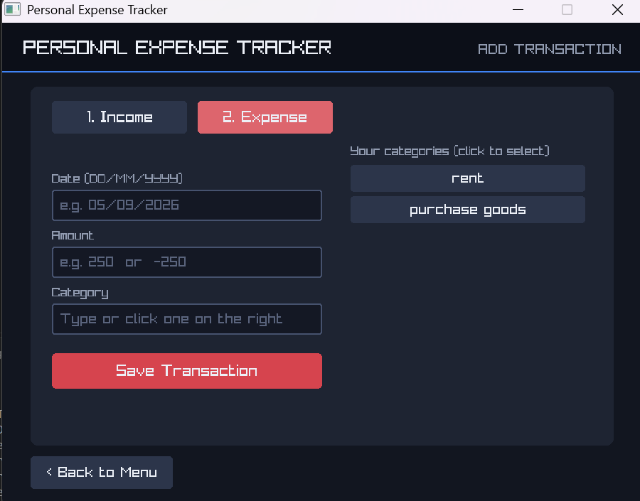
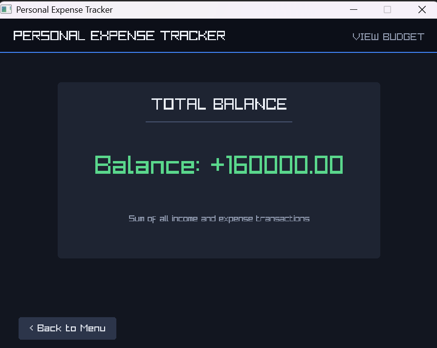
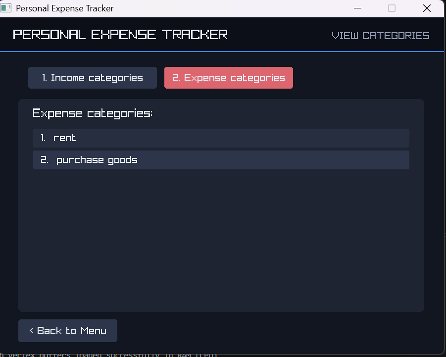
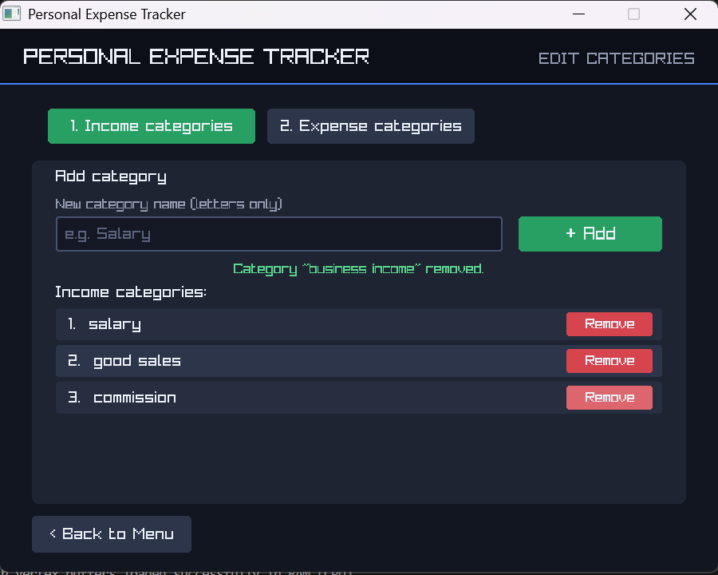
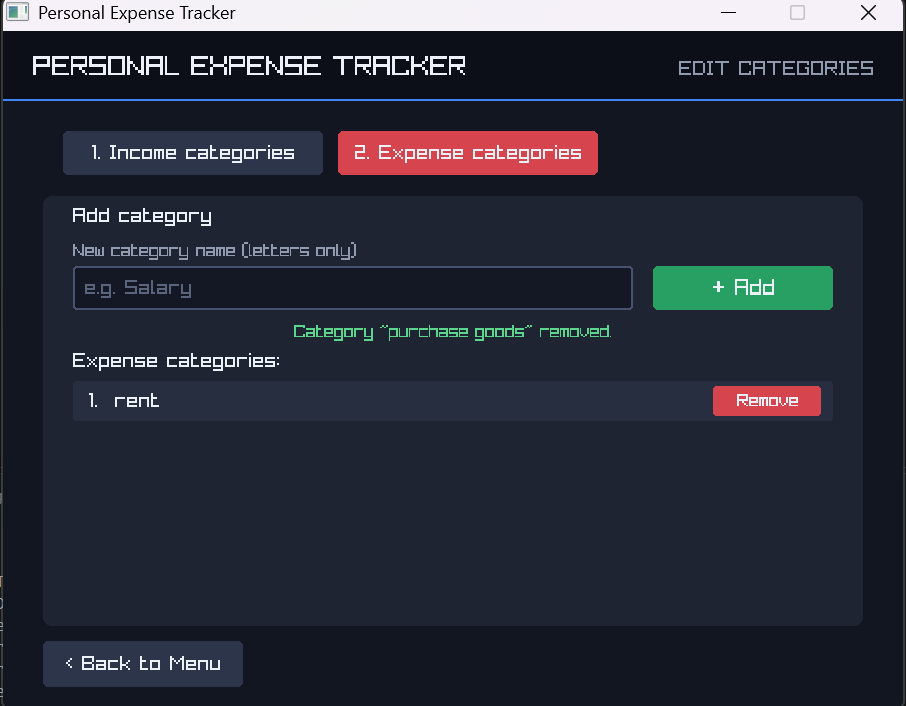
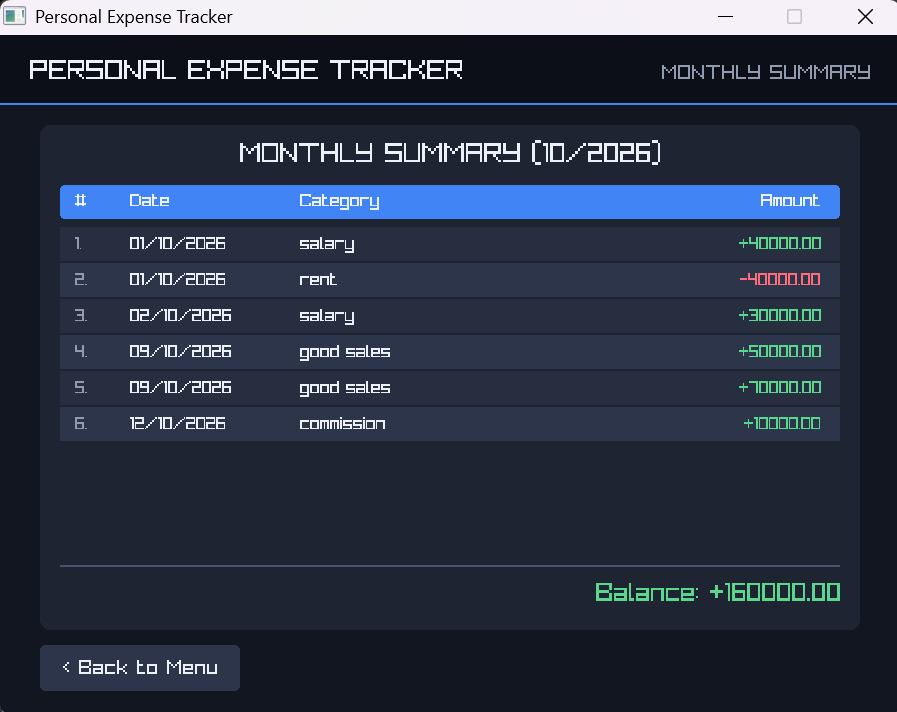

# Expenses Tracker

A desktop **Personal Expense Tracker** written in **C++** with the **raylib** graphics library. Register once, log in securely, record your income and expenses by category, and instantly see your total balance and a monthly summary, all in a simple button-based window.

> First-semester academic project (Bachelor of Information Technology)
> **Team:** Kapil Dahal · Saryan Shakya · Sujan Rai

---

## Table of Contents

- [Features](#features)
- [Screenshots](#assets)
- [Getting Started](#getting-started)
- [How to Use](#how-to-use)
- [Input Rules](#input-rules)
- [Data Files](#data-files)
- [How It Is Built](#how-it-is-built)
- [Limitations and Future Work](#limitations-and-future-work)
- [Team](#team)

---

## Features

- **Register and Login**: only the registered user can open the program; three wrong login attempts close it.
- **Password protection**: password rules are enforced and the password is saved as a **hash**, never as plain text.
- **Add transactions**: record an income or an expense with its date, amount and category.
- **Custom categories**: add and remove separate income and expense categories.
- **Input validation**: date format, real date, current month, amount and category are checked before saving.
- **View Budget**: total balance of all income and expense transactions.
- **Monthly Summary**: the current month's transactions sorted by day, with the balance.
- **Colour-coded display**: green for income, red for expenses.
- **Persistent storage**: data is saved in `user.dat`, `categories.dat` and `transactions.dat`, so nothing is lost when you close the program.

---

## Screenshots

### Register and Login

| Register | Login |
|---|---|
|  |  |

### Main Menu



### Add Transaction

| Income | Expense |
|---|---|
|  |  |

### Total Balance



### View Categories

| Income categories | Expense categories |
|---|---|
|  |  |

### Edit Categories

| Income categories | Expense categories |
|---|---|
|  |  |

### Monthly Summary



---

## Getting Started

### Requirements

| Item | Needed |
|---|---|
| Language | C++ (C++11 or newer) |
| Compiler | `g++` (MinGW-w64 on Windows) |
| Graphics library | [raylib](https://www.raylib.com) |
| Operating system | Windows 10 or later (Linux and macOS also work) |

### Install raylib

**Windows (easiest):** install the official [raylib installer](https://github.com/raysan5/raylib/releases). It includes MinGW-w64 and `g++`. Open its terminal (or add its `bin` folder to your `PATH`) and you are ready to build.

**Linux (Debian / Ubuntu):**
```bash
sudo apt update
sudo apt install build-essential git libasound2-dev libx11-dev libxrandr-dev libxi-dev libgl1-mesa-dev libglu1-mesa-dev libxcursor-dev libxinerama-dev
git clone https://github.com/raysan5/raylib.git
cd raylib/src && make PLATFORM=PLATFORM_DESKTOP && sudo make install
```

**macOS:**
```bash
brew install raylib
```

### Build and Run

1. **Clone the repository**
   ```bash
   git clone https://github.com/<your-username>/<your-repo>.git
   cd <your-repo>
   ```

2. **Compile** (run this in the folder that contains the `.cpp` files)

   **Windows (MinGW):**
   ```bash
   g++ *.cpp -o ExpensesTracker.exe -std=c++17 -lraylib -lopengl32 -lgdi32 -lwinmm
   ```

   **Linux:**
   ```bash
   g++ *.cpp -o ExpensesTracker -std=c++17 -lraylib -lGL -lm -lpthread -ldl -lrt -lX11
   ```

   **macOS:**
   ```bash
   g++ *.cpp -o ExpensesTracker -std=c++17 -lraylib -framework OpenGL -framework Cocoa -framework IOKit -framework CoreVideo
   ```

3. **Run**

   Windows: `ExpensesTracker.exe`  ·  Linux / macOS: `./ExpensesTracker`

> **Tip:** run the program from the project folder so the `.dat` data files are created and found in the same place every time.
> If the source files are inside a sub-folder (for example `src/`), change `*.cpp` to `src/*.cpp`.

---

## How to Use

1. **First run:** no account exists, so the **Create Account** screen opens. Enter a username, a password and the password again, then click **Register**.
2. **Login:** enter your username and password. You have **3 attempts**.
3. **Main Menu** options:
   1. **Add Transaction**: choose *Income* or *Expense*, enter date, amount and category (type it or click a saved category), then **Save Transaction**.
   2. **View Budget**: shows your total balance.
   3. **View Categories**: browse income and expense categories.
   4. **Edit Categories**: add a new category or **Remove** an existing one.
   5. **Monthly Summary**: this month's transactions by day, with the balance.
   6. **Exit**: close the program.
4. Use **< Back to Menu** on any screen to return to the main menu.

---

## Input Rules

| Field | Rule |
|---|---|
| Username | No spaces |
| Password | 5 or more characters, no spaces, at least 1 number and 1 special character (`@ # $ !`) |
| Date | `DD/MM/YYYY`, must be a real date in the **current month** |
| Amount | A valid number; wrongly signed or zero amounts are rejected |
| Category | Letters only; a category must exist before it can be used |

Income is stored as a **positive** amount and expense as a **negative** amount, so the balance is simply the sum of all transactions.

---

## Data Files

The program creates and uses three files:

| File | Stores |
|---|---|
| `user.dat` | Username and hashed password |
| `categories.dat` | Income and expense categories |
| `transactions.dat` | All income and expense transactions |

To reset the program, close it and delete these files; the Register screen will appear again on the next run.

---

## How It Is Built

The project uses **object-oriented programming** in C++ and keeps the data handling separate from the drawing code:

- **Model classes**: `InputHelper`, `UserAccount`, `Transaction`, `CategoryManager`, `TransactionManager` (data, validation, file handling)
- **Widget classes**: `Button`, `TextBox`, `Scroller` (reusable interface parts)
- **Screen classes**: `RegisterScreen`, `LoginScreen`, `MenuScreen`, `AddTransactionScreen`, `BudgetScreen`, `ViewCategoriesScreen`, `EditCategoriesScreen`, `MonthlySummaryScreen`
- **`AppContext` / `App`**: shares state between screens, creates the window and runs the main loop

---

## Limitations and Future Work

- Only **one user account** is supported (no multi-user).
- Saved transactions cannot be edited or deleted.
- Data is stored in plain data files, not a database.
- No charts, reports or budget alerts.

Possible improvements: multi-user support, editing and deleting transactions, charts and reports, budget alerts, and database storage.


